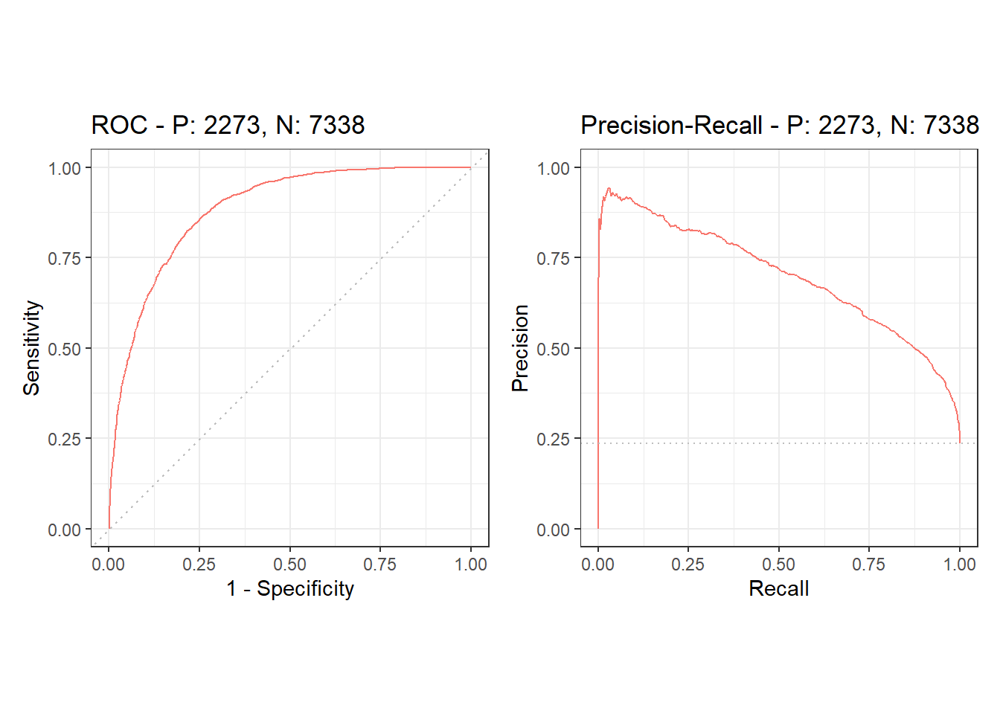

# m6APrediction

## Overview

Experimentally mapping N6-methyladenosine (m6A) sites is slow and
expensive, while RNA sequence data are cheap and abundant.
`m6APrediction` addresses this by applying a fitted random forest
classifier to sequence-derived genomic features (GC content, RNA type
and region, exon length, distance to the nearest splice junction,
evolutionary conservation, and the five-base sequence context) to score
candidate sites and classify them as `"Positive"` or `"Negative"`.

This is the package for my coursework.

## Installation

Install the package from GitHub with `devtools`:

``` r
# install.packages("devtools")
devtools::install_github("rakuyonn28-ux/m6APrediction")
```

Alternatively, use `remotes`:

``` r
# install.packages("remotes")
remotes::install_github("rakuyonn28-ux/m6APrediction")
```

## Example

The package exports two prediction functions:

- `prediction_multiple()` scores a data frame of candidate sites.
- `prediction_single()` scores one site and returns a named character
  vector.

The example data and the fitted model ship with the package in
`inst/extdata/`.

``` r
library(m6APrediction)

ml_fit <- readRDS(system.file("extdata", "rf_fit.rds", package = "m6APrediction"))
example_df <- read.csv(system.file("extdata", "m6A_input_example.csv",
                                   package = "m6APrediction"))

# Predict several sites at once
batch_result <- prediction_multiple(ml_fit, example_df[1:5, ],
                                    positive_threshold = 0.6)
batch_result[, c("predicted_m6A_prob", "predicted_m6A_status")]
#>   predicted_m6A_prob predicted_m6A_status
#> 1              0.876             Positive
#> 2              0.000             Negative
#> 3              0.498             Negative
#> 4              0.938             Positive
#> 5              0.208             Negative

# Predict a single site
prediction_single(ml_fit,
                  gc_content = 0.6368,
                  RNA_type = "mRNA",
                  RNA_region = "CDS",
                  exon_length = 10.7671,
                  distance_to_junction = 8.8826,
                  evolutionary_conservation = 0.2498,
                  DNA_5mer = "GGACA",
                  positive_threshold = 0.6)
#> predicted_m6A_prob predicted_m6A_status
#>             "0.936"           "Positive"
```

`exon_length` and `distance_to_junction` must already be
log2-transformed. `DNA_5mer` is the five-base DNA context with the
adenosine of interest in the central position.

## Model performance: ROC and precision-recall curves

The classifier was evaluated on a test set containing 2,273
positive and 7,338 negative sites (positive-to-negative ratio about
0.31). The figure below was produced from the test-set predictions.

<figure>

<figcaption aria-hidden="true">Complete ROC and precision-recall curves
with precrec</figcaption>
</figure>

Performance at two decision thresholds:

| Positive probability cutoff | Accuracy | Precision | Recall | FPR   |
|-----------------------------|----------|-----------|--------|-------|
| 0.5                         | 0.837    | 0.702     | 0.544  | 0.072 |
| 0.1                         | 0.686    | 0.426     | 0.941  | 0.394 |

The area under the ROC curve (AUROC) is **0.885**, and the area under
the precision-recall curve (AUPRC) is **0.700**. The PRC baseline is
**0.236**, equal to the proportion of positives in the test set.

**Interpretation.**  The model separates positive from negative sites well 
across a wide range of thresholds, and an AUROC of 0.885 confirms this. 
In the PRC curve, the AUPRC of 0.700 is roughly three times the baseline, 
so the model substantially enriches true m6A sites.


